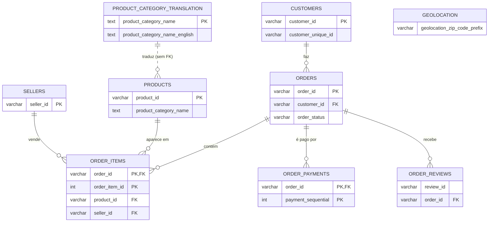

# Laboratório de Bancos de Dados para Análise de Dados

PostgreSQL, MySQL, SQL Server e Oracle: carga de dados, consultas analíticas, desempenho e runbooks de suporte.

## Objetivo

Praticar SQL e rotinas de suporte em quatro bancos relacionais, usando a mesma base de dados em todos. Cada exercício de suporte é tratado como um incidente: o que aconteceu, como foi diagnosticado, como foi recuperado e quanto tempo levou.

## Base de dados

A base usada é o *Brazilian E-Commerce Public Dataset by Olist*, publicada no Kaggle: https://www.kaggle.com/datasets/olistbr/brazilian-ecommerce. Ela reúne cerca de 100 mil pedidos de 2016 a 2018, em nove tabelas relacionadas: clientes, geolocalização, pedidos, itens do pedido, pagamentos, avaliações, produtos, vendedores e tradução de categorias.

Os arquivos não estão neste repositório. Para reproduzir o laboratório, baixe o zip na página acima e extraia os CSVs na pasta `dados/`, na raiz do projeto. Créditos à Olist pela disponibilização dos dados; a licença de uso é a informada na página do Kaggle.

## Modelo de dados

O diagrama mostra as chaves e as relações declaradas no banco. As colunas completas estão em `missao-01-postgresql/01_criar_tabelas.sql`. As tabelas `geolocation` e `product_category_translation` não têm chave estrangeira; a ligação da tradução com `products` é só lógica (pelo nome da categoria).



## Como reproduzir

Comandos executados no Windows com Docker Desktop (WSL 2) e PowerShell. Pré-requisitos: Docker Desktop e Git.

1. Clone o repositório e entre na pasta:

```powershell
git clone https://github.com/livioesf/lab-bancos-de-dados-analise.git
cd lab-bancos-de-dados-analise
```

2. Baixe a base (link na seção "Base de dados"), crie a pasta `dados` na raiz do projeto e extraia os CSVs nela.

3. Crie o arquivo `.env` a partir do exemplo e troque a senha em `POSTGRES_PASSWORD`:

```powershell
Copy-Item .env.example .env
notepad .env
```

4. Suba o banco:

```powershell
docker compose up -d
```

5. Crie as tabelas, carregue os dados e crie as relações:

```powershell
Get-Content missao-01-postgresql\01_criar_tabelas.sql -Raw | docker exec -i lab-postgres psql -U lab_admin -d olist -v ON_ERROR_STOP=1
Get-Content missao-01-postgresql\02_carregar_dados.sql -Raw | docker exec -i lab-postgres psql -U lab_admin -d olist -v ON_ERROR_STOP=1
Get-Content missao-01-postgresql\03_chaves_estrangeiras.sql -Raw | docker exec -i lab-postgres psql -U lab_admin -d olist -v ON_ERROR_STOP=1
```

6. Confira a carga. O resultado deve ser igual ao de `missao-01-postgresql/evidencias/contagem_antes.txt`:

```powershell
Get-Content missao-01-postgresql\contagem.sql -Raw | docker exec -i lab-postgres psql -U lab_admin -d olist
```

7. Para consultar o banco, abra uma sessão interativa:

```powershell
docker exec -it lab-postgres psql -U lab_admin -d olist
```

Para reproduzir a Missão 02, execute na ordem os cinco scripts de `missao-02-postgresql/` (`01` a `05`), do mesmo modo que os scripts da Missão 01. Um exemplo de comando está no relatório da missão.

## Tecnologias

- SQL
- PostgreSQL 16
- Docker e Docker Compose
- Git e GitHub

Os bancos de dados são adicionados conforme cada missão é concluída, e as ferramentas usadas aparecem no runbook correspondente.

## Missões

| # | Missão | Status |
|---|--------|--------|
| 01 | PostgreSQL: modelagem, carga dos dados, backup e restore com desastre simulado ([runbook](missao-01-postgresql/runbook-01-backup-restore.md)) | Concluída |
| 02 | PostgreSQL: consultas analíticas, views, plano de execução e índice ([relatório](missao-02-postgresql/relatorio-02-analise-e-desempenho.md)) | Concluída |
| 03 | MySQL, SQL Server e Oracle: mesma carga e mesmas consultas, com a tabela de diferenças entre dialetos | Planejada |
| 04 | Runbooks de suporte em cada banco: acesso, permissões e backup básico | Planejada |
| 05 | Dashboard conectado ao banco | Planejada |

## Formato dos runbooks

Todos seguem o mesmo padrão: incidente, impacto, diagnóstico, procedimento de recuperação, tempo gasto, prevenção e lições aprendidas.

## Autor

Lívio Emmanuel Silva Freire
[LinkedIn](https://linkedin.com/in/livio-emmanuel) | [GitHub](https://github.com/livioesf)

## Licença

MIT
